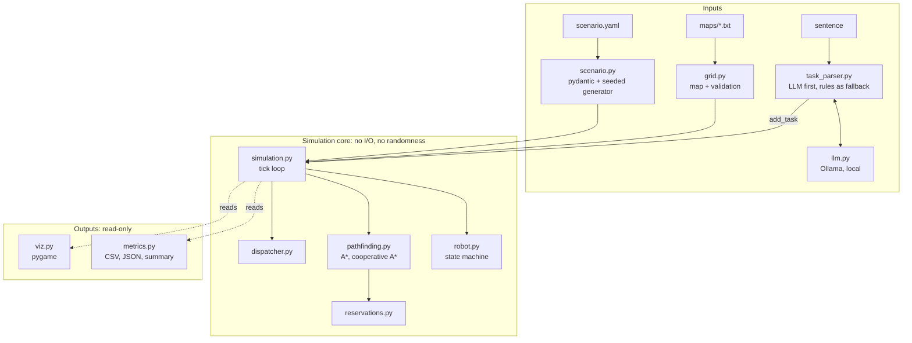
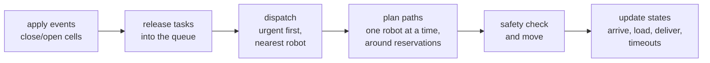

# Hospital Delivery Robot Fleet Simulator

[](https://github.com/Petus19/hospital-delivery-robot-sim/actions/workflows/ci.yml)


A 2D, discrete-time simulator of a fleet of autonomous robots that deliver
medication, lab samples and meals inside a hospital. It covers the core
problems of indoor delivery robotics: path planning, task dispatching,
multi-robot collision avoidance in narrow corridors, reacting to blocked
corridors, measuring fleet performance, and letting staff create tasks in
plain English or Slovak through a **local** language model.

<!-- GIF of the simulation: docs/demo.gif -->

## Why

In a hospital, several robots share the same corridors, doors and docking
spots with people. A useful fleet has to answer a few questions every second:

- **Which robot takes which order?** An urgent morphine delivery must not wait
  behind a meal tray.
- **How does each robot get there?** The shortest path is useless if another
  robot is coming the other way through a one-lane door.
- **What if the plan breaks?** A corridor is closed for cleaning, a dock is
  occupied, two robots wait for each other.
- **Is the fleet good enough?** How long does a ward wait for its delivery, and
  how busy are the robots?
- **How do nurses give orders?** A sentence is easier than a form, but the
  robot must never act on a misunderstood one.

This project implements simple, explainable answers to each of these questions
and keeps the core logic deterministic and fully tested.

## Features

- **Hospital map** from an ASCII file, validated on load (shape, walls,
  unknown symbols, unreachable areas).
- **A\*** path planning on a 4-connected grid with a Manhattan heuristic
  (own implementation).
- **Robot state machine**: `IDLE → TO_PICKUP → LOADING → TO_DROPOFF → UNLOADING → RETURNING`.
- **Dispatcher**: urgent tasks first, each task goes to the free robot with
  the shortest *real* path (A* length, not straight-line distance).
- **Multi-robot collision avoidance**: prioritized planning with a space-time
  reservation table (cooperative A* over `(x, y, t)`), handling both vertex and
  swap conflicts, plus an execution-time safety check.
- **Deadlock handling**: a robot that cannot plan steps aside from a dock or
  retreats to its charger after a timeout.
- **Dynamic obstacles**: cells closed from tick X to tick Y; affected robots
  replan.
- **Metrics and logging**: delivery and queue times, distance, waits, safety
  stops, utilisation; exported to CSV and JSON, plus a log file and a console
  summary.
- **YAML scenarios** with a seeded random task generator: the same seed always
  gives the same run.
- **Natural-language tasks** via a local LLM (Ollama) with structured output,
  validation and a rule-based fallback, so everything also works offline
  without a model.
- **Pygame viewer** (pause, single step, speed control, typed tasks) and a
  **headless** CLI mode.

## Quick start

Requires Python 3.12 or newer. Commands are shown for Windows PowerShell;
on Linux/macOS use `.venv/bin/python` instead of `.venv\Scripts\python.exe`.

```powershell
git clone https://github.com/Petus19/hospital-delivery-robot-sim.git
cd hospital-delivery-robot-sim
py -3.14 -m venv .venv                      # Linux/macOS: python3 -m venv .venv
.venv\Scripts\python.exe -m pip install -e ".[dev]"

.venv\Scripts\python.exe -m hospital_sim run scenarios/demo.yaml              # window
.venv\Scripts\python.exe -m hospital_sim run scenarios/demo.yaml --headless   # console only
```

### Optional: local language model

Natural-language input works without a model (rule-based parser). For the LLM:

1. Install Ollama from <https://ollama.com/download>.
2. Download a small model (about 1.9 GB; it runs on an ordinary laptop CPU):
   ```powershell
   ollama pull qwen2.5:3b
   ```
   On a machine with 8 GB RAM or less, `qwen2.5:1.5b` (about 1 GB) also works:
   pass `--model qwen2.5:1.5b`.
3. Try it:
   ```powershell
   .venv\Scripts\python.exe -m hospital_sim parse-task "doruč inzulín z lekárne na oddelenie 3, súrne"
   ```
   The output ends with `(understood by llm)`, or `(understood by rules)` when
   Ollama is not running.

## Usage

### Commands

| Command | What it does |
|---|---|
| `run <scenario.yaml>` | Run a scenario in a window |
| `run <scenario.yaml> --headless -q` | Run without a window, print only the summary |
| `run ... --seed 7` | Another reproducible "day" for scenarios with a generator |
| `run ... --ticks 300` | Override the maximum number of ticks |
| `run ... --task "bring morphine from the pharmacy to ward 9, urgent"` | Add a task given as a sentence (repeatable) |
| `run ... --out results` | Folder for results (default `output/`) |
| `parse-task "<sentence>"` | Show how a sentence is understood, without simulating |
| `--no-llm`, `--model NAME` | Skip the LLM, or use another Ollama model |

Every run prints a summary and writes `tasks.csv`, `robots.csv`,
`summary.json` and `sim.log` into `output/<scenario>_seed<seed>/`.

### Viewer controls

| Key | Action |
|---|---|
| `SPACE` | Pause / resume |
| `N` | One tick forward while paused |
| `↑` / `↓` | Faster / slower (1–32 ticks per second) |
| `T` | Type a new task as a sentence, `Enter` to send |
| `ESC` | Quit, then print and save the results |

Robot colours show their state (blue: to pickup, orange: loading, green: to
dropoff, purple: returning, grey: idle); a red ring marks an urgent task and
the line is the planned path.

### Scenarios

| File | Shows |
|---|---|
| `single_robot.yaml` | One robot, the full state machine |
| `demo.yaml` | Four robots, a morning medication round |
| `rush_hour.yaml` | Six robots, 30 overlapping tasks: a collision-avoidance stress test |
| `blocked_corridor.yaml` | The upper corridor closes from tick 15 to 150 |
| `random_day.yaml` | A generated shift; change it with `--seed` |

A scenario is a small YAML file:

```yaml
name: my_scenario
map: ../maps/hospital.txt
robots: 4                 # one per charging station, or give `starts: [[x, y], ...]`
seed: 42
max_ticks: 800
tasks:
  - {tick: 0, pickup: pharmacy, dropoff: ward_3, item: insulin, priority: urgent}
generator:                # optional random tasks
  rate: 0.05              # probability of a new task in each tick
  until_tick: 400
blockages:                # optional closed cells, (x, y) counted from the top-left
  - {cells: [[18, 4], [18, 5]], start: 15, end: 150}
```

Typos and unknown locations are rejected when the file is loaded.

## Architecture



The simulation core does not import pygame, Ollama or YAML. The viewer and the
metrics only read its state. This keeps the core deterministic and testable
without a display or a model.

### One tick



| Module | Responsibility |
|---|---|
| `grid.py` | Load and validate the ASCII map, neighbours, locations, passage detection |
| `pathfinding.py` | A* in space, cooperative A* in space and time |
| `reservations.py` | Who is where and when: cells, moves and parking |
| `robot.py` | Robot data and its state machine with legal transitions |
| `dispatcher.py` | Which free robot takes which task |
| `simulation.py` | The tick loop that ties everything together |
| `models.py` | `Task`, `BlockEvent`, enums |
| `scenario.py` | YAML scenarios, seeded task generator |
| `metrics.py` | Per-task and per-robot metrics, CSV/JSON export |
| `llm.py` / `task_parser.py` | Sentence → validated task (local LLM + rule-based fallback) |
| `viz.py` | Pygame viewer |
| `__main__.py` | Command line interface |

## Design decisions

**A\* on a grid.** A\* is BFS with a priority queue ordered by
`steps so far + Manhattan distance to goal`. On a 4-connected grid the
Manhattan distance never overestimates, so A\* returns a shortest path while
exploring fewer cells than BFS. A test compares it with BFS on every dock of
the map. Alternatives: Dijkstra (A\* without a heuristic), Jump Point Search
(faster on open grids, harder to explain).

**Discrete time.** One tick = every robot moves at most one cell. Collisions
are exactly defined, runs are deterministic, and tests can check invariants
after every tick. Continuous motion, dynamics and sensors belong in a physics
simulator (see *Next steps*).

**Prioritized planning with a reservation table.** Robots plan one at a time,
urgent ones first. Each robot runs A\* over `(x, y, t)`, where waiting is also a
move, and books its path in a shared table. Later robots treat the bookings as
obstacles. The table blocks both **vertex conflicts** (same cell, same tick)
and **swap conflicts** (two robots exchanging cells, which a cell-only check
misses). The last cell of every path stays booked until the robot plans again,
so a parked robot is never driven through.

*Trade-off against Conflict-Based Search (CBS).* CBS is optimal and complete:
it plans robots independently and splits on each conflict. Its cost grows
exponentially with the number of conflicts, which is a poor fit for a fleet
that receives new tasks all the time. Prioritized planning is fast and simple,
but it is **incomplete** (it can miss a solution that exists), **not optimal**,
and its result **depends on the planning order**. The deadlock handling below
covers the practical cases; CBS/ECBS is the natural next step.

**Two safety layers.** Planning should already avoid every conflict, but just
before robots move a second check stops any robot that would enter an occupied
or closed cell or swap with another robot. A stopped robot replans. This is the
same idea as a robot's own safety stop in front of an obstacle. In all bundled
scenarios the check never has to intervene (0 safety stops), and tests assert
that two robots are never on one cell and never swap.

**Deadlocks: timeout, then give way.** Only ticks without a usable plan count
(planned waits are fine). A robot blocking a dock steps aside to the nearest
cell where it blocks nobody after 3 ticks; a robot stuck in a doorway or a
one-lane passage retreats to its charger after 12 ticks. "Blocks nobody" is a
local check: the neighbours of the cell must still reach each other in the
surrounding 3×3 block without it.

**Dispatcher.** Greedy: urgent before normal, then first come, first served;
each task goes to the free robot with the shortest A\* path to the pickup.
Greedy assignment is not globally optimal (the Hungarian algorithm would be),
but it is predictable and cheap at this fleet size.

**Determinism.** All randomness happens before the simulation starts: the seed
turns into a fixed task list. The core has no clock and no random calls, and
ties are always broken by id. A test checks that two runs with the same seed
produce identical metrics, which also makes before/after comparisons fair.

**Local LLM.** Delivery requests can contain patient and medication data. A
local model (Ollama, `qwen2.5:3b`) keeps that data on the device, works
offline and needs no API key. Providers sit behind a one-method
`TaskExtractor` interface, so a cloud model could be added without touching
the rest of the code.

**The LLM proposes, deterministic code decides.** The model gets the allowed
locations in the prompt and in a JSON schema (structured output), and its
answer is validated with pydantic. Testing against the real model showed that
this is not enough: the schema forces the model to pick an allowed location,
so it *guessed* (`"ward 12"` → `ward_1`, `"make me a coffee"` →
`kitchen`). The answer is therefore accepted only if both locations are
actually named in the sentence; otherwise the rule-based parser decides,
and it rejects such requests. A robot never acts on an unverified model output.

**Validation at the boundaries.** Pydantic validates what comes from outside
(YAML, LLM output). Inside the core, plain dataclasses keep the code simple and
fast.

## Results

Headless runs of the bundled scenarios (times in ticks, one tick = one move):

| Scenario | Robots | Delivered | Avg delivery | Urgent / normal avg | Avg queue | Safety stops | Ticks |
|---|---|---|---|---|---|---|---|
| `demo` | 4 | 10/10 | 81 | 84 / 80 | 29 | 0 | 170 |
| `rush_hour` | 6 | 30/30 | 166 | **96 / 180** | 102 | 0 | 357 |
| `blocked_corridor` | 4 | 17/17 | 121 | 113 / 124 | 43 | 0 | 384 |
| `random_day` (seed 42) | 5 | 43/43 | 65 | 62 / 66 | 9 | 0 | 681 |

- Under load (`rush_hour`), urgent tasks are delivered almost twice as fast as
  normal ones. In the small `demo` the two urgent tasks go to the farthest wards,
  so their average is not lower.
- No scenario needed the safety layer: every conflict was resolved by planning.
- In `blocked_corridor` the robots detour through the lower corridor and return
  to the short route when the corridor reopens.

Natural-language input, 14 English and Slovak sentences (10 valid requests,
4 that must be rejected), real `qwen2.5:3b`:

| | Correct | Invalid requests turned into deliveries |
|---|---|---|
| LLM output trusted as is | 10/14 | 4 of 4 |
| LLM + grounding check + rule-based fallback | **14/14** | 0 |

## Testing and quality

- **98 tests** (pytest), no display and no Ollama needed: A\* against BFS,
  map validation, state machine, dispatcher, reservation table, cooperative A\*,
  collision invariants after every tick in full scenarios, deadlock recovery,
  blockages, metrics, determinism with seeds, the parsers (with a fake LLM and
  a fake Ollama client), CLI and viewer.
- **ruff** for linting and formatting, **type hints everywhere**, checked by
  **pyright** in standard mode.
- **GitHub Actions** runs ruff, pyright and pytest on Ubuntu with Python 3.12,
  3.13 and 3.14 for every pull request and every push to `main`.

```powershell
.venv\Scripts\python.exe -m pytest
.venv\Scripts\ruff.exe check .
.venv\Scripts\pyright.exe
```

## Limitations and next steps

Known limitations:

- Prioritized planning is incomplete and not optimal; extreme congestion can
  still need several give-way manoeuvres.
- Robots learn about a closed corridor only when it closes; known schedules
  could be booked into the reservation table in advance.
- Grid world: no continuous motion, kinematics, sensor noise or people.
- The rule-based parser understands simple sentences only, and the small LLM
  sometimes translates the item name.
- No batteries: robots park at their chargers but never need to charge.

Next steps:

- **ROS 2 + Gazebo/Nav2**: run the same fleet logic against simulated robots
  with real sensors; multi-robot traffic management in the style of Open-RMF.
- **Continuous space**: costmaps and local planners instead of grid cells.
- **CBS / ECBS** for optimal or bounded-suboptimal multi-robot paths.
- **Battery model and charging** as part of dispatching.
- **Reinforcement learning for dispatching**, compared with the greedy baseline
  using the existing metrics and seeded scenarios.
- Vision-language input (e.g. a photo of a handwritten request).

## Project structure

```
├── maps/hospital.txt        hospital layout (ASCII)
├── scenarios/*.yaml         ready-made scenarios
├── src/hospital_sim/        simulator package (see the module table above)
├── tests/                   pytest suite
├── pyproject.toml           dependencies, ruff, pyright, pytest settings
└── .github/workflows/ci.yml continuous integration
```

## License

[MIT](LICENSE)
